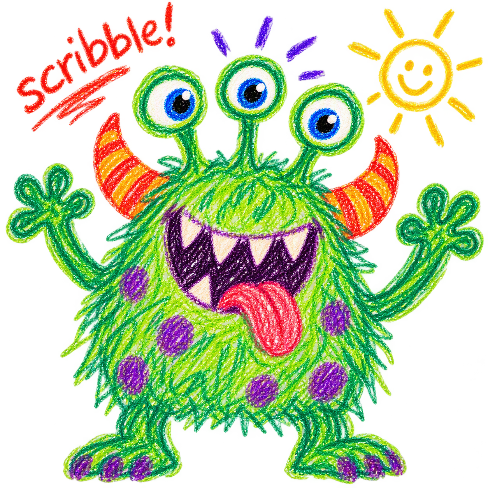

> a single-cell workflow based on scanpy


<br>

## Examples

- [Hippocampus](docs/examples/hippo_int.md)

## Core Analysis Workflow

### Data import and QC

- [Import](docs/import.md)
- [Mitochondrial QC](docs/mt.md)
- [Doublet Detection](docs/dbl.md)
- [PCA QC](docs/pca.md)
- [Filtering](docs/filter.md)

---


### Preprocessing and Integration

- [Preintegration](docs/preintegration.md)
- [Harmony Integration](docs/harmony.md)

### Clustering and Curation

- [Clustering](docs/cluster.md)
- [Cluster Evaluation](docs/evaluate.md)
- [Cluster Refinement](docs/refine.md)
- [Cluster Curation](docs/curate.md)

### Biological Annotation

- [Annotation](docs/annotate.md)

---

## Differential Expression and Pathway Analysis

### Differential Expression

- [DGE](docs/DGE.md)

### Cross-Analysis Comparison

- [DGE Compare](docs/DGE_compare.md)

### Interpretation and Reporting

- [DGE Report](docs/DGE_report.md)

---


## Workflow Summary

```text
import
  ↓
mt
  ↓
dbl
  ↓
pca
  ↓
filter
  ↓
preintegration
  ↓
harmony
  ↓
cluster
  ↓
evaluate
  ↓
refine
  ↓
curate
  ↓
annotate
  ↓
DGE
  ↓
DGE compare
  ↓
DGE report
```

---
